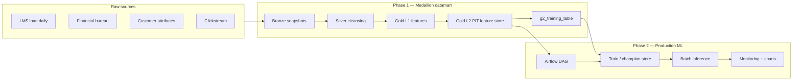
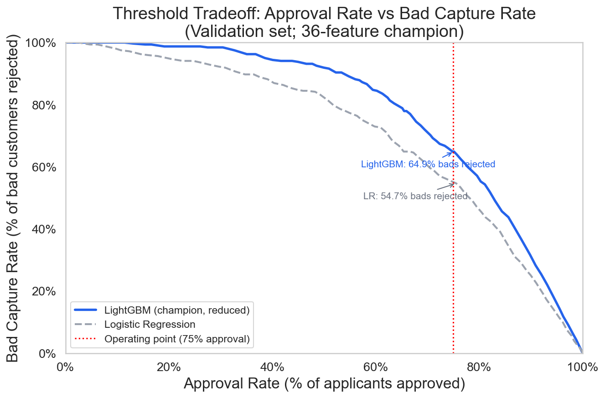

# Loan Default Risk — End-to-End ML Platform

Portfolio project from **SMU MITB CS611 (Machine Learning Engineering)**: predict **probability of default at loan application** (30+ DPD at month-on-book 6) for a cash-loan portfolio, from raw operational data through a governed production pipeline.

**Target:** `default_flag` at application time · **Champion model:** calibrated LightGBM (36 SHAP-selected features) · **OOT ROC-AUC:** ~0.81 · **Gini:** ~0.61

---

## What this repo contains

This is a **two-phase monorepo** — Assignment 1 (feature engineering) and Assignment 2 (ML ops) as one coherent story:

| Phase | Folder | Focus |
|-------|--------|--------|
| **1 — Feature store** | [`phase1-feature-store/`](phase1-feature-store/) | Medallion datamart (bronze → silver → gold), point-in-time `g2_feature_store`, labelled `g2_training_table` |
| **2 — ML pipeline** | [`phase2-ml-pipeline/`](phase2-ml-pipeline/) | Airflow-orchestrated train → score → monitor; Docker; drift & performance dashboards |

Phase 2 reuses and extends the Phase 1 datamart logic under `phase2-ml-pipeline/utils/datamart/` for scheduled snapshots.

---

## Architecture (high level)



See [`docs/architecture.md`](docs/architecture.md) for design decisions (splits, calibration, thresholding, retrain SOP).

---

## Quick start (recommended demo)

The production path lives in **Phase 2** and runs in Docker (Apache Airflow 2.7):

```bash
cd phase2-ml-pipeline
docker compose build
docker compose up
```

1. Open **http://localhost:8080** — login `admin` / `admin`
2. Trigger DAG **`loan_default_ml_pipeline`** (default snapshot `2024-07-01`)
3. After success, inspect `model_store/model_metadata.json`, `datamart/gold/predictions/`, and `outputs/charts/`

Local backfill without Airflow:

```bash
cd phase2-ml-pipeline
python -m pip install -r requirements.txt
python -m utils.run_local_backfill --start 2023-01-01 --end 2024-12-01 --force-retrain
```

Phase 1 only (batch medallion build):

```bash
cd phase1-feature-store
python -m pip install -r requirements.txt
python main.py --snapshotdate 2024-07-01 --training
```

---

## Tech stack

- **Data:** PySpark + Pandas gold backend (Windows-friendly), Parquet partitions, point-in-time joins
- **ML:** LightGBM, isotonic calibration, SHAP-driven feature reduction, cost-based decision threshold
- **Orchestration:** Airflow (monthly schedule, backfillable), Docker Compose
- **Monitoring:** ROC-AUC / Gini / KS / Brier, score & feature PSI, approval & bad-rate KPIs
- **Research:** Jupyter notebooks (EDA, tuning, monitoring) under `phase2-ml-pipeline/notebooks/`

---

## Repository layout

```
loan-default-risk-ml/
├── README.md                 ← you are here
├── docs/architecture.md
├── phase1-feature-store/     Assignment 1 — medallion + training table
└── phase2-ml-pipeline/       Assignment 2 — Airflow DAG, train/infer/monitor
```

Feature definitions: [`phase2-ml-pipeline/FEATURE_CATALOG.md`](phase2-ml-pipeline/FEATURE_CATALOG.md)

---

## Results snapshot (champion model)

Held-out **out-of-time** evaluation (see `phase2-ml-pipeline/model_store/model_metadata.json`):

| Split | ROC-AUC | Gini | KS |
|-------|---------|------|-----|
| Random test | 0.84 | 0.67 | 0.53 |
| OOT (3 cohorts) | 0.81 | 0.61 | 0.48 |

Production monitoring example (Jul 2024 snapshot): ROC-AUC **0.86**, Gini **0.71** on mature labels — see `phase2-ml-pipeline/outputs/charts/monitoring_summary.json`.



---

## Context & license

Developed as coursework at **Singapore Management University, MITB — CS611**. Synthetic / course-provided data only; not production financial advice. See [`docs/DATA.md`](docs/DATA.md) and [`SECURITY.md`](SECURITY.md).

MIT License — see [`LICENSE`](LICENSE).
