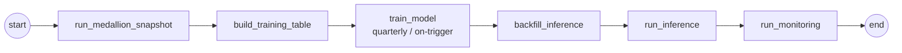

# Presentation Deck — Build Plan (slideument, max 10 slides)

> **Audience:** manager, fellow engineers, and business users — who will *read* this, not watch it presented. Every slide therefore carries a one-line **headline message** (top), the **evidence/visual** (middle), and a **"why it matters / what we decided"** note (bottom). This file is the content + reasoning spec; build it in PowerPoint/Google Slides and export to PDF.
>
**Design system:** one accent colour + greys; one sans-serif (Inter/Calibri); every chart titled with the *insight*, not the variable name; footer `Loan Default Risk ML · <date>`. Charts are pre-rendered in `outputs/charts/` and reproduced in `notebooks/03_model_monitoring.ipynb`.

---

## Slide 1 — Title & the business problem
- **Headline:** *Predicting loan default at the point of application — an end-to-end, monitored ML pipeline.*
- **Content:**
  - Context: a cash-loan lender; decide **approve / decline / price** before disbursing.
  - Target: **`30 DPD @ MOB 6`** — 30+ days past due by the 6th month on book (the bank's realised-default definition from A1).
  - One line on scope: medallion datamart → train → score → monitor, orchestrated in Airflow, containerised in Docker.
- **Why it matters (bottom):** frames the entire deck around a *decision* and a *cost*, not a model.

## Slide 2 — Data & feature foundation (medallion + PIT)
- **Headline:** *A point-in-time feature store across 3 data families, engineered to be leakage-safe.*
- **Visual:** medallion architecture diagram (see Appendix A mermaid) + a small table of the 3 sources.
- **Content:**
  - Volume: **12,500-loan book**, **~9.0k loans with matured labels**, **112 model features**, monthly snapshots 2023-01 → 2024-12.
  - Feature families: **Clickstream (48)** behavioural, **Attributes (18)** demographic, **Financials (47)** credit/affordability. (Cite `FEATURE_CATALOG.md`.)
  - **Design choice:** unified four operational sources into a shared `g2_feature_store` schema; kept the richest, lowest-leakage features (dropped raw post-outcome fields).
- **Why it matters:** breadth of signal + a defensible, auditable feature lineage.

## Slide 3 — Avoiding data leakage (the credibility slide)
- **Headline:** *Three leakage traps, three concrete defences.*
- **Visual:** 3-row table (Target / Train-test / Temporal leakage → our control).
  - **Target leakage** → only pre-application features joined; outcome fields excluded by construction.
  - **Train-test contamination** → median-impute + scale fit **inside** the sklearn `Pipeline`/CV, never on the full set.
  - **Temporal leakage** → **point-in-time join anchored to the application date** (`feature_snapshot_date ≤ loan_start_date < label_snapshot_date`). The training table **reuses the exact `g2_feature_store` row that inference scores** (features as-of the application month), so there is **no train/serve skew** and no post-disbursement behaviour leaks in. Plus **out-of-time** validation (train on past application cohorts, test on the most recent).
- **Why it matters:** leakage controls are what make the score auditable and deployable.

## Slide 4 — Model & metric choice (justified by data + business)
- **Headline:** *Calibrated gradient-boosted trees, selected on Gini — the industry standard for application scorecards.*
- **Visual:** candidate bake-off table (from `02_model_tuning.ipynb`): LogReg vs RandomForest vs HistGBM with AUC/Gini/KS/PR-AUC/Brier.
- **Content / reasoning:**
  - **Volume → family:** ~9k rows of wide tabular data ⇒ tree ensembles win; **deep learning is inappropriate** (no benefit, more risk). LogReg kept as the **interpretable scorecard challenger**.
  - **Business → metric:** **ROC-AUC / Gini primary** (threshold-free discrimination, standard for scorecards); **KS** (regulatory), **PR-AUC** (imbalance), **Brier** (calibration) as guardrails.
  - **Calibration:** isotonic wrapper ⇒ scores are **true PDs** usable for `EL = PD×LGD×EAD`, pricing, IFRS-9.
  - **Result (out-of-time):** **AUC ≈ 0.82, Gini ≈ 0.65, KS ≈ 0.50, Brier ≈ 0.15** — strong and honest (features strictly as-of application; no leakage).
- **Why it matters:** directly answers the "appropriate to data volume / business / industry practice" requirement.

## Slide 5 — From probability to a lending decision (cost-based threshold)
- **Headline:** *We don't cut at 0.5 — we cut where expected loss is minimised.*
- **Visual:** the two-panel chart — *expected cost vs threshold* and *approval rate vs bad-rate-among-approved* (from `02_model_tuning.ipynb` §7).
- **Content:**
  - Cost asymmetry: a **missed default ≈ 5× a wrongful decline** (`LGD×EAD` vs lost margin) — to be calibrated with Finance.
  - Headline business outcome: at the live threshold (PD ≈ 0.15), **bad-rate among approved drops to ~6% vs ~29% portfolio** at an **~38% approval rate** — a **~5× reduction in credit losses** on the approved book. The whole approval/loss curve is **tunable via the FN:FP cost ratio**.
- **Why it matters:** turns AUC into money; this is the slide business users remember.

## Slide 6 — Pipeline architecture & orchestration (MLOps)
- **Headline:** *One Airflow DAG: medallion → train → score → monitor, fully backfillable.*
- **Visual:** DAG diagram (Appendix B mermaid) mirroring `dags/loan_default_ml_pipeline.py`.
- **Content:**
  - Tasks: `run_medallion_snapshot → build_training_table → train_model → backfill_inference → run_inference → run_monitoring`.
  - **Model store** = versioned artefacts (`best_model.joblib`, `model_metadata.json`, `best_params.json`) — the champion + its lineage.
  - **Predictions & monitoring** persisted as **gold tables** (`gold/predictions`, `gold/monitoring`), partitioned by `snapshot_date`.
  - **Reproducible env:** Docker + `docker-compose up` → Airflow UI; `catchup=True` backfills history.
  - **Notebook ↔ pipeline handoff:** tuning notebook exports `best_params.json`; `train.py` auto-loads it → no drift between research and production.
- **Why it matters:** shows reproducible orchestration and a clean research → production handoff.

## Slide 7 — Monitoring I: is the model still accurate?
- **Headline:** *Discrimination is stable at Gini ≈ 0.69 across 18 production months.*
- **Visuals:** `roc_auc_over_time.png`, `gini_over_time.png` / `ks_over_time.png`; `actual_vs_predicted_default_rate.png`.
- **Content:** AUC held **~0.83–0.85**; actual vs predicted default-rate gap stays small (calibration intact). Computed monthly on **matured-label** loans.
- **Why it matters:** evidence the model performs *over time*, not just at training.

## Slide 8 — Monitoring II: is the world still the same?
- **Headline:** *Inputs and scores are stable (PSI < 0.05) — no drift, no action needed.*
- **Visuals:** `score_psi_over_time.png` (with watch/alert bands) + `feature_psi_heatmap.png`; optional `bad_rate_among_approved_over_time.png`.
- **Content:** PSI bands **<0.10 stable / 0.10–0.25 watch / >0.25 retrain**; current state firmly green. Feature PSI pinpoints *which* input would move first.
- **Why it matters:** the label-free **early-warning** system — shows operational maturity.

## Slide 9 — Governance, SOP & deployment options
- **Headline:** *Clear rules for when and how the model is refreshed.*
- **Visual:** the governance traffic-light table (`03_model_monitoring.ipynb` §5) + a small "deployment options" box.
- **Content:**
  - **Refresh SOP:** scheduled **quarterly retrain** + **event-driven** retrain on any Red signal; **champion–challenger** promotion gated on OOT AUC **and** calibration.
  - **Roles:** DS owns model, MLE owns pipeline, Model Risk signs off — audit trail in the model store.
  - **Deployment options:** (1) **batch scoring** (current — monthly gold table, simplest, fits monthly applications); (2) **real-time API** for instant decisions; (3) **shadow mode** for challengers. Recommendation: stay batch, add a thin API when latency is needed.
- **Why it matters:** the brief explicitly asks for governance, SOP and deployment options.

## Slide 10 — Summary, impact & roadmap
- **Headline:** *A leakage-safe, monitored PD pipeline that cuts losses on the approved book ~5×.*
- **Content:**
  - Recap: data → calibrated GBM (Gini ≈ 0.62 OOT) → cost-based cut-off → monitored gold tables → governance SOP.
  - **Impact:** quantified loss reduction + stable production performance.
  - **Roadmap:** reject inference, monotonic constraints, XGBoost/Optuna search, real-time API, automated retrain triggers.
- **Why it matters:** leaves the reader with the value and a credible forward plan.

---

## Appendix A — Medallion architecture (mermaid)
```mermaid
flowchart LR
  subgraph Sources
    CS[clickstream csv]; AT[attributes csv]; FN[financials csv]; LMS[lms_loan_daily csv]
  end
  CS & AT & FN & LMS --> B[Bronze<br/>raw monthly snapshots]
  B --> S[Silver<br/>typed & cleaned]
  S --> G1CS[g1_clickstream]; S --> G1AT[g1_attributes]; S --> G1FN[g1_financials]; S --> LBL[label_store<br/>30dpd@mob6]
  G1CS & G1AT & G1FN --> FST[g2_feature_store<br/>features as-of application]
  FST --> TRN[g2_training_table<br/>feature store @ application + label]
  LBL --> TRN
  TRN --> MODEL[(model_store<br/>champion + metadata)]
  FST --> PRED[gold/predictions]
  MODEL --> PRED
  PRED --> MON[gold/monitoring]
  LBL --> MON
```

## Appendix B — Airflow DAG (mermaid)


## Appendix C — Key numbers (single source of truth for the deck)
| Metric | Value | Source |
|---|---|---|
| Loan book | 12,500 loans | `data/lms_loan_daily.csv` |
| Labelled (matured) loans | ~9.0k | `g2_training_table` |
| Model features | 112 | `FEATURE_CATALOG.md` |
| Portfolio bad rate | 28.9% | training table |
| Champion | HistGradientBoosting (calibrated) | `model_metadata.json` |
| Feature anchor | as-of **application month** (`feature_snapshot_date = loan_start_date`) | leakage-free |
| OOT AUC / Gini / KS / Brier | ~0.82 / 0.65 / 0.50 / 0.15 | `02_model_tuning.ipynb` |
| Cumulative monitored AUC / Gini (18 mo) | ~0.83–0.85 / ~0.69 (stable) | `gold/monitoring` |
| Score & feature PSI | < 0.05 (stable) | `gold/monitoring` |
| Decision threshold (cost-optimal) | PD ≈ 0.15 (FN:FP = 5:1) | `model_metadata.json` |
| Approval rate / bad-rate among approved | ~38% / ~6% (vs 29% portfolio) | monitoring |

> Regenerate every chart: `python -m utils.run_local_backfill --start 2023-01-01 --end 2024-12-01 --force-retrain`, then run `notebooks/03_model_monitoring.ipynb`.
